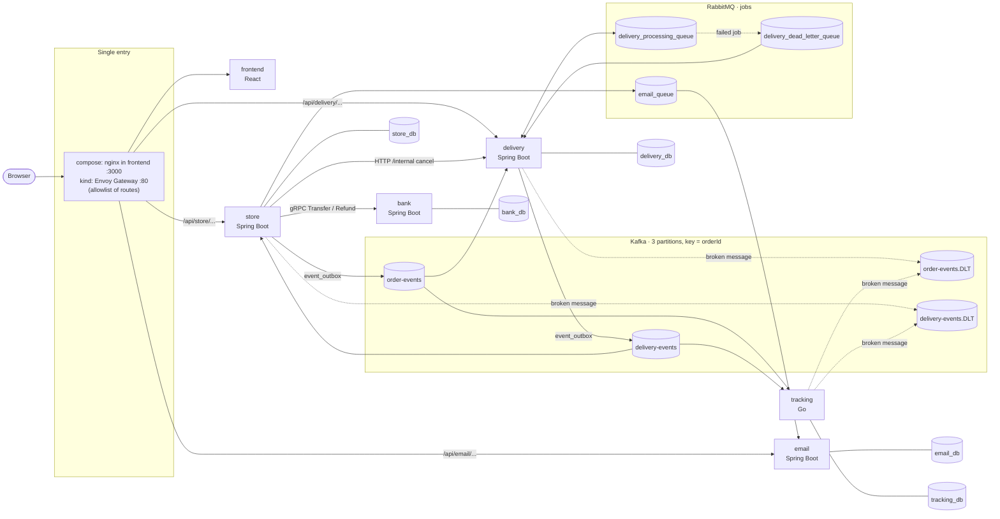

# Microservices E-Commerce Platform

**English** | [中文](README.zh-CN.md)

An online shop split into five services that talk through Kafka events, RabbitMQ jobs and one gRPC call. The point of the project is the hard part of a distributed checkout: a customer must be **charged exactly once**, **refunded exactly once** when something goes wrong, and an order must never get stuck or move backwards, even when a broker, the bank or a consumer is down at the wrong moment.

It started as a team project for COMP5348 (Enterprise-Scale Software Development) at the University of Sydney: four Spring Boot services, one shared database and RabbitMQ. I then redesigned and extended it on my own: idempotent payments, a database per service, Kafka with an outbox, a Go read service, gRPC between store and bank, and a local Kubernetes deployment. Each change was built test-first and checked with end-to-end scenario scripts.

## Architecture



- **Kafka carries facts** ("order paid", "parcel lost"). Every producer writes the event into its own `event_outbox` table in the same transaction as the business change; a publisher sends it later.
- **RabbitMQ carries jobs**: delivery's simulated courier steps (one job per step, about 10 s apart) and store's emails.
- **gRPC** is used for the one call where money moves: store → bank.
- **One PostgreSQL server, one database and one login per service.** No service reads another service's database.
- **The entry is an allowlist**: only the method + path pairs the frontend uses are forwarded; `/internal`, `/actuator` and anything unlisted get 404 at the entry ([k8s/gateway/routes.yaml](k8s/gateway/routes.yaml), [frontend/nginx.conf](frontend/nginx.conf)).

## Services

| Service | Language / framework | What it owns | Database | Interfaces |
|---|---|---|---|---|
| **store** | Java 17, Spring Boot 3.5 | users and login (JWT), products and warehouse stock, orders, payments; starts every charge and refund | `store_db` | REST `/api/user`, `/api/products`, `/api/orders`, `/api/store/...`, `/api/payments`; produces `order-events`, consumes `delivery-events`; gRPC client of bank; publishes to `email_queue` |
| **bank** | Java 17, Spring Boot 3.5, grpc-java | accounts and money transfers | `bank_db` | gRPC `BankService.Transfer` / `Refund` on :9090 ([bank.proto](backend/contracts/src/main/proto/bank/v1/bank.proto)); REST `/api/bank/...` for accounts and balances |
| **delivery** | Java 17, Spring Boot 3.5 | deliveries and the simulated courier (CREATED → PICKED_UP → DELIVERING → RECEIVED, or LOST) | `delivery_db` | REST `/api/deliveries/...`, `/api/admin/dlq/...`, `/internal/deliveries/cancel-by-order/{orderId}`; consumes `order-events`, produces `delivery-events`; RabbitMQ job queue |
| **email** | Java 17, Spring Boot 3.5 | verification codes and notification emails (Gmail SMTP) | `email_db` | REST `/api/email/...`; consumes `email_queue` |
| **tracking** | Go 1.27, franz-go, pgx | a read-only timeline of every event per order | `tracking_db` | `GET /api/tracking/orders/{orderId}/timeline`; consumes both topics |
| frontend | React 19, served by nginx | shop UI | — | the single entry in compose (`localhost:3000`) |

Shared event and gRPC definitions live in [backend/contracts](backend/contracts/README.md): one `EventCodec`, example JSON for every event type, and contract tests that both the Java services and the Go service run against.

## Reliability design

Each rule below is enforced in code and covered by tests. The reasoning behind each one is in the [architecture decision records](docs/adr/README.md); code comments cite them by number.

| Problem | What the code does | Where |
|---|---|---|
| A retried charge must not charge twice | Every charge and refund carries an idempotency key (`PAY-{paymentId}-{attempt}-{random}` / `REFUND-{paymentId}-{random}`). bank stores it under a unique constraint, locks both account rows in a fixed order and checks the key again under the lock; the same key with different content is rejected as a conflict. A timeout is `PAY_UNKNOWN`, not a failure: it is retried with the **same** key ([ADR-04](docs/adr/04-single-money-path-idempotent.md), [ADR-05](docs/adr/05-timeout-is-not-failure.md), [ADR-16](docs/adr/16-unguessable-idempotency-keys.md)). | [BankService.java](backend/bankService/src/main/java/com/comp5348/bank/service/BankService.java), [PaymentService.java](backend/storeService/src/main/java/comp5348/storeservice/service/PaymentService.java) |
| A charge or refund must survive a crash | store never calls bank inside a request. It writes a PAY / REFUND task to `payment_outbox` in the same transaction as the order change; `OutboxProcessor` runs the tasks with fast and slow retries. | [OutboxProcessor.java](backend/storeService/src/main/java/comp5348/storeservice/scheduler/OutboxProcessor.java) |
| An event must not be lost between "commit" and "send" | Events are rows in each service's `event_outbox`, written in the business transaction. A publisher sends them in id order, one Kafka ack at a time, under `pg_try_advisory_xact_lock` so two instances never send the same rows (ADR-06). If Kafka is down, orders still get paid; events wait in the table. | store [EventOutboxPublisher.java](backend/storeService/src/main/java/comp5348/storeservice/events/EventOutboxPublisher.java), delivery [EventOutboxPublisher.java](backend/deliveryService/src/main/java/com/comp5348/delivery/service/events/EventOutboxPublisher.java) |
| Saga compensation: a lost parcel | delivery publishes `Lost`; store marks the order LOST and writes a REFUND task in the same transaction; when bank confirms, the order becomes REFUNDED and `OrderRefunded` is published. | [DeliveryEventService.java](backend/storeService/src/main/java/comp5348/storeservice/service/DeliveryEventService.java) |
| Cancel races the delivery being created | If the customer cancels before delivery has read `OrderPaid`, delivery inserts a **cancel marker** (a CANCELLED row for that order). When the late `OrderPaid` arrives it finds the row and creates nothing (ADR-09). | [DeliveryService.java](backend/deliveryService/src/main/java/com/comp5348/delivery/service/DeliveryService.java) |
| Kafka delivers at least once | Consumers commit the offset only after their database transaction. Duplicates are harmless: delivery keeps one row per order, tracking inserts with `ON CONFLICT (event_id) DO NOTHING`, store ignores events that would not move the order forward. | [OrderEventsConsumer.java](backend/deliveryService/src/main/java/com/comp5348/delivery/service/events/OrderEventsConsumer.java), [store.go](backend/trackingService/internal/store/store.go), [DeliveryEventsConsumer.java](backend/storeService/src/main/java/comp5348/storeservice/events/DeliveryEventsConsumer.java) |
| Events arrive late or out of order | Status never goes backwards: store ranks CREATED < PICKED_UP < DELIVERING < final and skips any event that is not above the order's current rank. All events of one order share a partition key (`orderId`), so they stay in order (ADR-07). | [DeliveryEventService.java](backend/storeService/src/main/java/comp5348/storeservice/service/DeliveryEventService.java) |
| A poison message must not block a partition, a short outage must not lose events | Failures are split in two. A message that cannot be parsed goes straight to `<topic>.DLT`. Known transient trouble (database down, lock timeout) is retried in place with back-off for as long as it lasts, so the partition waits and per-order order is kept. Anything else is retried 5 times, then dead-lettered with an `ALERT` log. Go and Java write the same DLT headers (ADR-08). | delivery [KafkaConsumerConfig.java](backend/deliveryService/src/main/java/com/comp5348/delivery/service/events/KafkaConsumerConfig.java), store [KafkaConsumerConfig.java](backend/storeService/src/main/java/comp5348/storeservice/events/KafkaConsumerConfig.java), tracking [dlt.go](backend/trackingService/internal/consumer/dlt.go) |
| A delivery job lost while RabbitMQ is down | Found by scenario 05: a delivery created while RabbitMQ was down stayed CREATED forever. A sweeper now re-sends the job of any non-final delivery that has not moved for 60 s; it claims the row with a conditional `UPDATE` first, so two instances never both resend. | [StuckDeliveryJobSweeper.java](backend/deliveryService/src/main/java/com/comp5348/delivery/service/messaging/StuckDeliveryJobSweeper.java), [learning note 09](docs/learning/09-stuck-delivery-job-sweeper.md) |

Also: stock is reserved with pessimistic row locks ([learning note 04](docs/learning/04-inventory-pessimistic-lock.md)); unpaid orders are cancelled automatically after a timeout, re-checked under the order's row lock ([UnpaidOrderCanceller.java](backend/storeService/src/main/java/comp5348/storeservice/scheduler/UnpaidOrderCanceller.java)).

## End-to-end scenarios

Scripts in [backend/docker/scenarios](backend/docker/scenarios/README.md) drive the running system through the HTTP API, then check each service's own database. Each one registers a fresh user, so they can be run again. They need PowerShell 7.

| Scenario | What happens | Run |
|---|---|---|
| **Order and pay** | One order goes PAID → PICKED_UP → IN_TRANSIT → DELIVERED; the account is charged once; the tracking timeline shows all six events in order. | `pwsh backend/docker/scenarios/06-sequence-a-order-to-received.ps1` |
| **Lost parcel → refund** | delivery is restarted with a 100% loss rate; the order goes LOST → REFUNDED, the customer is refunded once and the balance is back where it started. | `pwsh backend/docker/scenarios/07-sequence-b-lost-refund.ps1` |
| **Cancel races delivery** | Kafka is stopped so `OrderPaid` arrives late; the customer cancels first. The cancel marker stops the late event: no delivery is created, one refund, stock returned. | `pwsh backend/docker/scenarios/08-sequence-c-cancel-before-delivery-reads.ps1` |

Add `-Target kind` to run 04–08 on the Kubernetes cluster instead of compose. Failure scenarios 01–05 cover double Pay Now, cancel after paying, bank down during payment, Kafka down, and RabbitMQ down; see the [scenario README](backend/docker/scenarios/README.md).

## Quick start

You need Docker Desktop and PowerShell 7. All commands run from the repository root.

### Docker Compose

```powershell
Copy-Item backend/.env.example backend/.env
# Fill in backend/.env: every *_PASSWORD, and JWT_SECRET (at least 64 characters).
# MAIL_USERNAME / MAIL_PASSWORD can stay empty: emails are then not sent, the rest works.

docker compose -f backend/compose.yml up -d --build --wait   # first build takes several minutes
pwsh backend/docker/smoke-order.ps1                          # one order: PAID, charged once, delivery moves
```

Open http://localhost:3000 and register a user (new users get a bank account with 10,000). Other addresses on this machine:

| What | Address |
|---|---|
| shop | http://localhost:3000 |
| store / delivery / email / bank / tracking | `localhost:8082` / `8081` / `8083` / `8084` (gRPC `9090`) / `8085` |
| PostgreSQL | `localhost:5433` (user `postgres`, databases `store_db`, `bank_db`, ...) |
| RabbitMQ management | http://localhost:15672 |
| Kafka (from the host) | `localhost:9094` |

Stop with `docker compose -f backend/compose.yml stop`. `down -v` also deletes the database volume.


### Kubernetes (kind)

The same images on a one-node [kind](https://kind.sigs.k8s.io/) cluster, behind a single entry at `http://localhost` (Envoy Gateway, Gateway API). Needs kind v0.33 and kubectl 1.33 or newer; details in [k8s/README.md](k8s/README.md).

```powershell
docker compose -f backend/compose.yml stop     # do not run compose and kind at the same time
docker compose -f backend/compose.yml build    # kind uses the shop-* images built by compose
./k8s/scripts/up.ps1                           # creates the cluster, loads images, applies k8s/ (about 5 min the first time)
./k8s/scripts/smoke-order.ps1
```

Remove it with `kind delete cluster --name shop` (this deletes the cluster's data; the compose volume is not touched).

### Environment variables

All secrets come from `backend/.env` (git-ignored; template in [backend/.env.example](backend/.env.example)). compose passes each container only the variables it needs, and `k8s/scripts/apply-secrets.ps1` turns the same file into one Secret per service.

| Variable | Used by |
|---|---|
| `POSTGRES_PASSWORD` | PostgreSQL superuser |
| `STORE_DB_PASSWORD`, `BANK_DB_PASSWORD`, `DELIVERY_DB_PASSWORD`, `EMAIL_DB_PASSWORD`, `TRACKING_DB_PASSWORD` | one login per service database, created on the first start of an empty volume |
| `RABBITMQ_USERNAME`, `RABBITMQ_PASSWORD` | RabbitMQ |
| `JWT_SECRET` | store signs login tokens (HS512, at least 64 characters) |
| `MAIL_USERNAME`, `MAIL_PASSWORD` | email: a Gmail address and a 16-character app password |

The full list of addresses and settings for Kafka and gRPC is in [docs/wave2-config-contract.md](docs/wave2-config-contract.md).

## Tests

The Java integration tests and the Go integration tests start real PostgreSQL, Kafka and RabbitMQ with Testcontainers, so Docker must be running. Stop the compose stack and the kind node first; they compete for memory and make the containers slow to start.

```powershell
cd backend
./gradlew test                        # every Java module (store has the most tests and takes several minutes)
./gradlew :bankService:test           # or one module: contracts, storeService, bankService, deliveryService

cd trackingService
go test ./...                         # unit tests
go test -tags integration -count=1 ./...   # plus real Postgres + Kafka (2–3 minutes)
```

What the tests cover, beyond unit tests:

- **contracts**: every example event decodes and re-encodes the same in Java; the Go service runs the same examples.
- **bank**: concurrent transfers from one account, repeated and conflicting idempotency keys.
- **store**: idempotency keys and unknown results, Pay Now twice, refunds, cancel after payment, unpaid-order auto-cancel, concurrent stock holds, publishing `order-events`, consuming `delivery-events` and the DLT, and an architecture test that only `OutboxProcessor` calls bank.
- **delivery**: cancel marker, duplicate `OrderPaid`, lost parcels, DLT, and the stuck-job sweeper with RabbitMQ stopped and started again.
- **tracking**: crashes before and after the database write, broken messages to the DLT, cross-topic ordering, rebalance, replay and graceful shutdown, against real Kafka and Postgres.

The end-to-end scenarios above run against a live stack and are the last check before a merge. The frontend has `npm test` (Create React App), but its one test, `App.test.js`, currently fails (see below).

## Repository layout

```
backend/
  storeService/  bankService/  deliveryService/  emailService/   Spring Boot services (Gradle multi-project)
  trackingService/       Go service (own go.mod, Dockerfile, README)
  contracts/             shared event envelope, topic names, bank.proto, example events
  compose.yml            the whole system on one machine
  Dockerfile             one image recipe for every Java service (build arg SERVICE)
  docker/postgres/init/  creates one database and login per service
  docker/scenarios/      end-to-end scenario scripts (01–08)
  docker/smoke-order.ps1 happy-path check
frontend/                React app; nginx.conf is the compose entry
k8s/                     kind config, base (Postgres, Kafka, RabbitMQ), apps, gateway, scripts
docs/
  adr/                   architecture decision records
  learning/              design notes, one per change (English and Chinese)
  wave2-config-contract.md   ports, addresses and topic names shared by all services
  legacy/                notes from the original course project (RabbitMQ-only design)
```

## Design docs

- [docs/adr/](docs/adr/README.md): architecture decision records ADR-01 to ADR-22 (what was decided, why, what it costs, where the code is), and the eight reliability rules that code comments cite.
- [docs/learning/](docs/learning/): one note per change, each explaining the problem, the failing test that reproduced it, the fix and the trade-offs.
  - [00 Event contract](docs/learning/00-event-contract.md) · [01 Idempotent payments](docs/learning/01-idempotent-payments.md) · [02 Docker and a database per service](docs/learning/02-docker-database-per-service.md) · [03 Go tracking consumer](docs/learning/03-go-tracking-consumer.md) · [04 Inventory pessimistic lock](docs/learning/04-inventory-pessimistic-lock.md) · [05 gRPC bank call](docs/learning/05-grpc-bank-call.md) · [06 Kafka delivery events](docs/learning/06-kafka-delivery-events.md) · [08 Kubernetes on kind](docs/learning/08-kubernetes-on-kind.md) · [09 Stuck delivery job sweeper](docs/learning/09-stuck-delivery-job-sweeper.md)
- Module READMEs: [contracts](backend/contracts/README.md), [delivery](backend/deliveryService/README.md), [tracking](backend/trackingService/README.md), [k8s](k8s/README.md), [scenarios](backend/docker/scenarios/README.md).
- [docs/wave2-config-contract.md](docs/wave2-config-contract.md): configuration shared between services.

## Known limitations and next steps

- **No service-to-service authentication.** delivery's `/internal/...` endpoint and bank's gRPC service accept any caller inside the network, and bank's balance endpoint answers without a token; the entry's allowlist is the only thing keeping them private. Some store and delivery endpoints (for example store's refund endpoint) still need proper authorization checks.
- **Single replicas.** Every stateful component runs once, and store runs one replica because `OutboxProcessor` has no lock across instances.
- **Occasional 503 at the kind entry** (finding I2): a read through Envoy Gateway was once reset before reaching store; a retry passed. Not yet explained.
- **Scenario scripts 01–03 run on compose only**; 04–08 also run on kind.
- **Frontend test**: `App.test.js` fails on `main` (it is the Create React App sample test, and jest cannot resolve `react-router-dom` when it runs).
- **Next**: deploy to a cloud Kubernetes service (AKS is the plan), and replace the RabbitMQ-driven courier simulation with a workflow engine.
