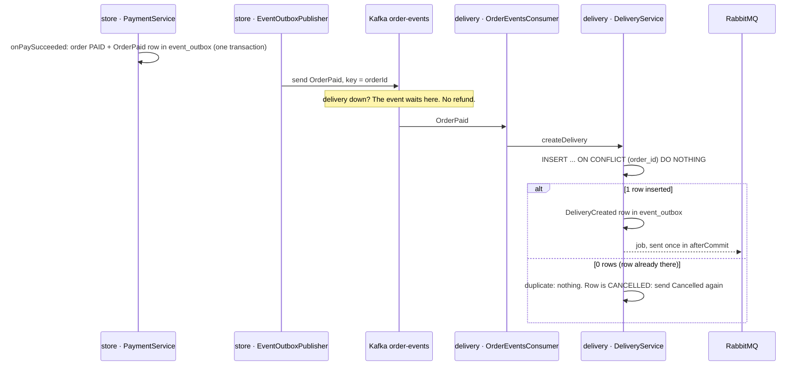
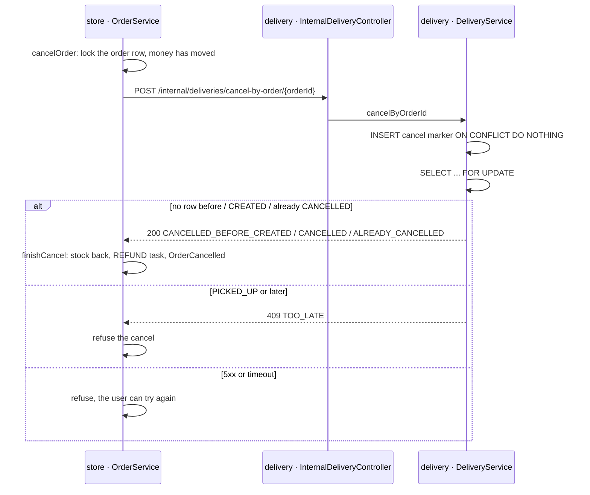

# 07 · order-events on Kafka: store stops creating deliveries over HTTP

**English** | [中文](07-kafka-order-events.zh-CN.md)

> Commits: `17bd8e0 test(red)` → `a9d6fc6 feat` (wave 2 A · 4b, branch `claude/wave2-kafka-656c13`); fixes after the reviews are in 2.7
> Replay time: **50 minutes** (new here: de-duplication by unique constraint on the consumer side, the cancel marker, the four answers of the cancel API, sending the job after commit)
> Before this: [06 · delivery-events on Kafka](06-kafka-delivery-events.md) (the outbox table and publisher, consumer groups, two kinds of failure + DLT; this note reuses all of them).
> Failure-scenario table: Obsidian `开发/电商项目/17-第2波A-Kafka-失败场景表.md`, groups B and C, plus store's copy of group P.
> This note used to be part 2 of note 06; it was split out so the numbers match the Obsidian cards.

---

## 1. Problem

**After a successful charge, store called `/api/deliveries/create` over HTTP. On cancel it only asked delivery if store already knew the deliveryId. With Kafka in between, both lose money.**

- delivery restarts for 30 seconds: store's HTTP create fails 3 times → writes `DELIVERY_FAILED` → 30 seconds later "compensation" refunds and cancels. **The user's order is gone because delivery restarted.**
- Between payment and DeliveryCreated coming back, store's `deliveryId` is null. The user cancels then → the old code **does not ask delivery**, refunds → delivery reads OrderPaid afterwards and ships. **Money back, parcel shipped.**
- Cancelled before payment, and the charge lands late: nothing stops delivery from creating the delivery.
- delivery's `order_id` is not unique: the same OrderPaid twice → two deliveries.
- delivery sent the job to RabbitMQ **inside** the transaction, twice (the same queue name on two lines): a worker faster than the commit finds no row and drops the job → the delivery stays CREATED forever.
- Reproduced by (red `17bd8e0`, 42 new tests, all red):
  - store publishes no events: [OrderEventsPublishingIntegrationTest.java](../../backend/storeService/src/test/java/comp5348/storeservice/events/OrderEventsPublishingIntegrationTest.java)
  - store cancels without asking delivery: [StoreCancelIntegrationTest.java](../../backend/storeService/src/test/java/comp5348/storeservice/events/StoreCancelIntegrationTest.java)
  - delivery down means refund: [DeliveryDownIntegrationTest.java](../../backend/storeService/src/test/java/comp5348/storeservice/events/DeliveryDownIntegrationTest.java), [DeliveryAccessArchitectureTest.java](../../backend/storeService/src/test/java/comp5348/storeservice/architecture/DeliveryAccessArchitectureTest.java)
  - delivery does not read order-events: [OrderEventsConsumerIntegrationTest.java](../../backend/deliveryService/src/test/java/com/comp5348/delivery/events/OrderEventsConsumerIntegrationTest.java)
  - the new cancel endpoint: [CancelByOrderApiIntegrationTest.java](../../backend/deliveryService/src/test/java/com/comp5348/delivery/events/CancelByOrderApiIntegrationTest.java)
  - old table, new consumer group: [DeliveryFreshEnvironmentIntegrationTest.java](../../backend/deliveryService/src/test/java/com/comp5348/delivery/events/DeliveryFreshEnvironmentIntegrationTest.java)
  - job after commit: [DeliveryJobAfterCommitIntegrationTest.java](../../backend/deliveryService/src/test/java/com/comp5348/delivery/events/DeliveryJobAfterCommitIntegrationTest.java)
  - old endpoints removed: [OldDeliveryEndpointsRemovedTest.java](../../backend/deliveryService/src/test/java/com/comp5348/delivery/events/OldDeliveryEndpointsRemovedTest.java)

## 2. What it is (framework level)

### 2.1 store: the same outbox, five events
- Table and publisher copied from delivery ([06](06-kafka-delivery-events.md), 2.1 and 2.2): [EventOutbox.java](../../backend/storeService/src/main/java/comp5348/storeservice/model/EventOutbox.java), [EventOutboxPublisher#publishBatch](../../backend/storeService/src/main/java/comp5348/storeservice/events/EventOutboxPublisher.java). Difference: store's `order_id` is a number column, turned into a string for the key.
- Writing an event: [OrderEventRecorder#record](../../backend/storeService/src/main/java/comp5348/storeservice/events/OrderEventRecorder.java), `MANDATORY` again, and it checks the payload type matches the event type.
- Five call sites, each inside the transaction that makes the change:

| Event | Where | Note |
|---|---|---|
| OrderPlaced | [OrderProductService#createOrderWithPayment](../../backend/storeService/src/main/java/comp5348/storeservice/service/OrderProductService.java) | same transaction as the order, the stock hold and the PAY task |
| OrderPaid | [PaymentService#onPaySucceeded](../../backend/storeService/src/main/java/comp5348/storeservice/service/PaymentService.java) | only on the "order not cancelled" branch; the payload carries everything delivery needs, so delivery never calls store |
| PaymentFailed | [PaymentService#onPayRejected](../../backend/storeService/src/main/java/comp5348/storeservice/service/PaymentService.java) | only when bank definitely said no; a timeout (PAY_UNKNOWN) is **not** one (rule 7) |
| OrderCancelled | [OrderService#finishCancel](../../backend/storeService/src/main/java/comp5348/storeservice/service/OrderService.java) | in `finishCancel`, which user cancel, the timeout and delivery's Cancelled all go through; reason `USER_REQUEST` / `PAYMENT_TIMEOUT` |
| OrderRefunded | [PaymentService#onRefundSucceeded](../../backend/storeService/src/main/java/comp5348/storeservice/service/PaymentService.java) | reason worked out at [PaymentService#refundEventReason](../../backend/storeService/src/main/java/comp5348/storeservice/service/PaymentService.java): order LOST → `DELIVERY_LOST`; charge after cancel → `PAID_AFTER_CANCEL`; else `ORDER_CANCELLED` |

- **Why the publisher is not `@Scheduled`**: [EventOutboxPublisher#start](../../backend/storeService/src/main/java/comp5348/storeservice/events/EventOutboxPublisher.java) implements `SmartLifecycle` and runs its own thread. Spring's default `taskScheduler` has **one thread**, shared by every `@Scheduled` method; an OutboxProcessor round calling bank can take seconds (fast retries), and events would wait behind it.
  - Found at green: store's test base replaces `taskScheduler` with a never-firing mock (so OutboxProcessor only runs when a test calls it). The copied `@Scheduled` publisher never ran in tests.
  - Tried `@Scheduled(scheduler = "my bean")` next, then realised that **registering any `TaskScheduler` bean makes Spring Boot skip its default one** (**to be confirmed**: read from `@ConditionalOnMissingBean` on Boot's `TaskSchedulingConfigurations`, not tested in this project), so in production every scheduled task would share that one thread. Hence a private thread that is not a bean.

### 2.2 delivery: de-duplicate with a unique constraint + `ON CONFLICT DO NOTHING`
- Creating: [DeliveryService#createDelivery](../../backend/deliveryService/src/main/java/com/comp5348/delivery/service/DeliveryService.java)
  ```sql
  INSERT INTO delivery (...) VALUES (..., 'CREATED', ...)
  ON CONFLICT (order_id) DO NOTHING
  ```
  1 row inserted → new delivery, write DeliveryCreated; 0 rows → this order already has a row (a repeat OrderPaid, or the **cancel marker** an earlier cancel left), do nothing.
- Why not "status never goes backwards" like store: OrderPaid is not "entered a state", it is "go and do something (create a delivery)". Twice means two deliveries, so it needs the database's unique constraint, not "look first": two threads looking at once both see nothing.
- Consumer: [OrderEventsConsumer#onOrderEvent](../../backend/deliveryService/src/main/java/com/comp5348/delivery/service/events/OrderEventsConsumer.java). OrderPaid → create; OrderCancelled → cancel (next section); other types (OrderPlaced, PaymentFailed, OrderRefunded, anything added later) are read past, no DLT.
- Consumer settings and error handling copied from store: group `delivery`, `earliest`, `ack-mode=record`, 3 threads, the three kinds of failure in [KafkaConsumerConfig.java](../../backend/deliveryService/src/main/java/com/comp5348/delivery/service/events/KafkaConsumerConfig.java).

### 2.3 The cancel marker and the four answers of the cancel API
- Code: [DeliveryService#cancelByOrderId](../../backend/deliveryService/src/main/java/com/comp5348/delivery/service/DeliveryService.java). **Insert first, then lock**:
  ```java
  int inserted = jdbc.update("INSERT ... VALUES (0, ?, 'CANCELLED', ...) ON CONFLICT (order_id) DO NOTHING", ...);
  Delivery d = deliveryRepository.findByOrderIdForUpdate(orderId).orElseThrow();   // SELECT ... FOR UPDATE
  ```

| Case | Does | Answer |
|---|---|---|
| no row yet | the inserted row is the **cancel marker** (status CANCELLED, no address or email) + Cancelled (deliveryId null) | 200 `CANCELLED_BEFORE_CREATED` |
| CREATED | → CANCELLED + Cancelled | 200 `CANCELLED` |
| already CANCELLED | nothing | 200 `ALREADY_CANCELLED` |
| PICKED_UP or later | nothing | 409 `TOO_LATE` + current status |

- Why insert first: `SELECT ... FOR UPDATE` cannot lock a row that **does not exist yet**. A cancel and an OrderPaid arriving together would both find nothing; one inserts a marker, the other a delivery. Inserting first: the two INSERTs meet on the unique index, the second **waits for the first to commit**, then does nothing; the `FOR UPDATE` after it always sees the row. One row, CANCELLED, every time (`cancelAndOrderPaid_atTheSameTime_oneRowEndsCancelled` runs 10 orders).
- Endpoint: [InternalDeliveryController#cancelByOrder](../../backend/deliveryService/src/main/java/com/comp5348/delivery/controller/InternalDeliveryController.java), under `/internal/*`, outside the user-token filter, **no authentication** (question 2, option a; on the security to-do list).
- OrderCancelled (cancelled before payment) uses the same method. If it answers TOO_LATE, the two services disagree (store thinks unpaid, the parcel is moving): `ALERT`, no change ([OrderEventsConsumer#onOrderEvent](../../backend/deliveryService/src/main/java/com/comp5348/delivery/service/events/OrderEventsConsumer.java)).

### 2.4 store cancel: a PAID order always asks delivery first
- Code: [OrderService#cancelOrder](../../backend/storeService/src/main/java/comp5348/storeservice/service/OrderService.java), [DeliveryAdapter#cancelByOrderId](../../backend/storeService/src/main/java/comp5348/storeservice/adapter/DeliveryAdapter.java)

| delivery says | store does |
|---|---|
| any of the three 200s | one transaction: order CANCELLED, stock back, REFUND task, OrderCancelled |
| 409 | refuse: "already picked up" |
| 5xx / no answer (5 s timeout) | refuse: "try later". It **does not know** whether delivery stopped, so it must not refund first |

- The condition changed from "`deliveryId != null`" to "the order is PAID". This is the heart of the 4b red (C6). **Changed again after review** (4b #1, see 2.7): decide by money. A SUCCESS payment, a known deliveryId, or status PAID / PROCESSING: any one means ask first.
- The order row stays locked while store asks delivery (at most 5 seconds): consumers for that order wait. The design did not ask to change this; noted in 09 (C8).

### 2.5 Fixing delivery's old table at startup; sending the job after commit
- [DeliverySchemaUpgrade#upgrade](../../backend/deliveryService/src/main/java/com/comp5348/delivery/config/DeliverySchemaUpgrade.java): `DROP NOT NULL` (a cancel marker has no address or email) + `CREATE UNIQUE INDEX IF NOT EXISTS`. Same timing as store's `OrderStatusCheckUpgrade`. **If the unique index cannot be built, startup fails**: without it, de-duplication would quietly stop working.
- [DeliveryService#createDelivery](../../backend/deliveryService/src/main/java/com/comp5348/delivery/service/DeliveryService.java): the RabbitMQ job goes out in `TransactionSynchronization.afterCommit`, once. What is left: a crash after commit and before the send leaves that delivery at CREATED (noted in 09).

### 2.6 Removed
- store: `DeliveryAdapter.createDelivery`, `CompensationService`, the create and 30-second compensation in OutboxProcessor, `DeliveryRequestDTO` / `DeliveryResponseDTO`. Leftover `SUCCESS` / `DELIVERY_FAILED` tasks in the database are closed with a WARN ([OutboxProcessor#processOutboxMessage](../../backend/storeService/src/main/java/comp5348/storeservice/scheduler/OutboxProcessor.java); question 4, option a: check for them by hand before upgrading).
- delivery: `/api/deliveries/create`, `/create/batch`, the old `/api/deliveries/cancel-by-order`, and their entries in the token filter's allow-list. `GET /{deliveryId}` now matches digits only; otherwise `POST /create` matched it and answered 405 instead of 404.

### 2.7 Fixes after the independent reviews (4a, 4b)
Each one: a failing test first, then the fix. Ids are from the failure-scenario table (Obsidian note 17).
| Review | Problem | Fix | Code |
|---|---|---|---|
| 4a #1 (A17) | A Cancelled after pick-up still finished the cancel and refunded (Cancelled is final, so "never go backwards" let it through) | Finish the cancel only while the order is PAID / PROCESSING and the delivery id matches; otherwise ALERT and skip | [DeliveryEventService#apply](../../backend/storeService/src/main/java/comp5348/storeservice/service/DeliveryEventService.java) |
| 4a #2 (D10) | A lock timeout while returning stock was swallowed; the transaction was already aborted, the next error looked like a bug, 5 retries, then the DLT: no refund | Stop swallowing: `unholdProduct` / `recordOutTransaction` rethrow, `finishCancel` has no try/catch; the lock timeout is seen as transient and retried in place | [OrderService#finishCancel](../../backend/storeService/src/main/java/comp5348/storeservice/service/OrderService.java), [WarehouseService#unholdProduct](../../backend/storeService/src/main/java/comp5348/storeservice/service/WarehouseService.java) |
| 4b #1 (C10) | The order status can be set back to "unpaid" through an old endpoint with no auth, then the cancel refunds without asking delivery | Decide by money whether to ask delivery (see 2.4) | [OrderService#cancelOrder](../../backend/storeService/src/main/java/comp5348/storeservice/service/OrderService.java) |
| 4b #2 (B13) | A cancel marker arrived before payment and store dropped its Cancelled; the OrderPaid then hit the marker and the order stayed PAID forever | When OrderPaid hits a CANCELLED row, delivery publishes Cancelled again; store already handles repeats | [DeliveryService#createDelivery](../../backend/deliveryService/src/main/java/com/comp5348/delivery/service/DeliveryService.java) |
| 4b #3 | The delivery id check compared the id with itself (filled in from the same event first) | Compare with the id store knew before this event; if it knew none, do not compare (one delivery per order) | [DeliveryEventService#apply](../../backend/storeService/src/main/java/comp5348/storeservice/service/DeliveryEventService.java) |

## 3. Request path (payment succeeds → delivery created; cancel right after paying)

```
store · OutboxProcessor → bank charge succeeds → PaymentService.onPaySucceeded
  tx: lock order row → order PAID, Payment SUCCESS → event_outbox gets OrderPaid ── commit
store · EventOutboxPublisher (own thread, every 1 s) → order-events, key=orderId
delivery · OrderEventsConsumer (group delivery, 3 threads)                          (OrderEventsConsumer#onOrderEvent)
  → DeliveryService.createDelivery @Transactional
      INSERT … ON CONFLICT (order_id) DO NOTHING → 1 row
      event_outbox gets DeliveryCreated; afterCommit registered
  ← commit → afterCommit: RabbitMQ job (once) → offset committed
delivery · EventOutboxPublisher → delivery-events → store saves the deliveryId (note 06)

The user cancels now (store may not know the deliveryId yet):
store · OrderService.cancelOrder
  lock order row → order is PAID → POST /internal/deliveries/cancel-by-order/{id}
     delivery: INSERT marker ON CONFLICT → 0 rows (delivery exists) → FOR UPDATE → CREATED → CANCELLED + Cancelled
     ← 200 {"result":"CANCELLED"}
  finishCancel: stock back, CANCELLED, REFUND task, OrderCancelled ── commit
delivery later reads OrderCancelled → ALREADY_CANCELLED, nothing to do
store reads Cancelled → order already CANCELLED (never backwards), nothing to do
```

The same path as diagrams. Payment succeeds → delivery is created:



The user cancels a paid order (store may not know the deliveryId yet):



## 4. Why this way

| Option | Why not / why |
|---|---|
| Keep HTTP create and add a Kafka event too | Two ways to create: delivery down still triggers the refund compensation on the HTTP path; only the unique constraint stops two deliveries |
| delivery reads OrderPaid and calls store back for address and email | Brings the synchronous dependency back: store down means no deliveries. The contract makes OrderPaid carry everything |
| delivery "looks first" before creating | Two threads look at once, both see nothing → two deliveries. It has to be a database unique constraint |
| On cancel, `SELECT ... FOR UPDATE` first, then decide to insert | Cannot lock a missing row; cancel and OrderPaid each insert one |
| 🤖 INSERT ON CONFLICT first, then FOR UPDATE (chosen; the design's cancel API section) | The unique index does the queuing; cost: each ON CONFLICT uses up an identity value, so delivery ids skip (the real run showed 2, 5, 8) |
| 🤖 timeout / 5xx always refuse the cancel | Refunding without knowing could mean "money back, parcel shipped"; cost: while delivery is down a paid order cannot be cancelled |
| 🤖 the publisher has a private thread, not `@Scheduled` | default scheduler has one thread; registering a TaskScheduler bean makes Boot skip its own (to be confirmed) |
| 🤖 `GET /{deliveryId:[0-9]+}` | so the removed `POST /create` answers 404, not 405 |

🤖 Also chosen by the AI: the answer field names (`result`, `status`); the index name `ux_delivery_order_id`; PaymentFailed only on a bank rejection (not for "no bank account linked"); OrderRefunded's reason derived from the order status and the refund task's text; LOST / REFUNDED / CANCELLED_SYSTEM orders can no longer be cancelled (they could before).

## 5. Interview topics here

**Verdict: this step has real work — creating a delivery moves from a synchronous call to subscribing to an event, de-duplication from "look first" to a unique constraint, and cancel from "maybe ask" to "always ask first". No distributed transaction, no saga orchestrator.**

| Topic | Code | Judgement here |
|---|---|---|
| 📒 F3 Idempotency | `ON CONFLICT` at `DeliveryService#createDelivery` | For "do something" messages, a unique constraint; for "entered a state" messages (store's side), status never going backwards |
| 📒 F4 Outbox | `OrderEventRecorder#record` | one in store, one in delivery, same table and publisher |
| 📒 F5 Saga / compensation | the removed `CompensationService` | the old compensation turned a temporary failure into a permanent one. Now OrderPaid waits in Kafka, no compensation needed |
| 📒 F9 Event-driven | delivery subscribes to OrderPaid | store does not know who creates deliveries; cost: cancel must cover "event still on its way" (the cancel marker) |
| 📒 E3 Pessimistic lock | `findByOrderIdForUpdate` | locks existing rows; **cannot lock a missing row**, so insert first |
| 📒 E5 Indexes (unique index) | `ux_delivery_order_id` | two INSERTs on a unique index: the second waits for the first to commit; the database queues them |
| 📒 D4 @Transactional | RabbitMQ job in `afterCommit` | side effects after commit; cost: a crash after commit loses that side effect |
| 📒 E6 Schema change | `DeliverySchemaUpgrade#upgrade` | second time with idempotent SQL; a third time and it is Flyway's turn |
| ➕ `INSERT ... ON CONFLICT DO NOTHING` | `DeliveryService#createDelivery` | returns 0/1 rows; one round trip fewer than look-then-insert, and no race |
| ➕ Spring's scheduler has one thread by default | `EventOutboxPublisher#start` | registering your own TaskScheduler bean removes the default (to be confirmed, see 2.1) |

### Scenarios (3)

**① F3 Idempotency: the same OrderPaid arrives twice**
- Scenario: store's publisher sends OrderPaid, restarts before marking it sent, sends it again next round. delivery gets two identical OrderPaid.
- Old code: `order_id` not unique, both `save(new Delivery(...))` → two deliveries → the worker moves both → the user gets emails for two parcels, the warehouse ships twice.
- New code: [DeliveryService#createDelivery](../../backend/deliveryService/src/main/java/com/comp5348/delivery/service/DeliveryService.java)
  ```sql
  INSERT INTO delivery (...) VALUES (...) ON CONFLICT (order_id) DO NOTHING
  ```
  The second inserts 0 rows and returns.
- Interview answer: "Kafka is at-least-once, so the consumer must be idempotent. Creating a delivery is an action, so I used a unique order id with ON CONFLICT DO NOTHING; my test sends the same event three times and gets one delivery."
- When **not**: the message means "entered a state" (store receiving PickedUp): never going backwards is enough. The message means "add one" (points): you need an eventId table.

**② E3 A pessimistic lock cannot lock a missing row: cancel and OrderPaid at the same moment**
- Scenario: the user cancels right after paying. In the same millisecond store calls delivery's cancel API, delivery's consumer is handling this order's OrderPaid.
- If you `SELECT ... FOR UPDATE` first: neither side finds the row (not created yet), nothing gets locked → cancel inserts a marker, OrderPaid inserts a delivery → with a unique constraint one of them errors, without one both rows exist → the delivery ships.
- New code: [DeliveryService#cancelByOrderId](../../backend/deliveryService/src/main/java/com/comp5348/delivery/service/DeliveryService.java) `INSERT ... ON CONFLICT DO NOTHING` first, then `findByOrderIdForUpdate`. The two INSERTs meet on the unique index; the second waits for the first to commit.
- Interview answer: "FOR UPDATE only locks rows that exist. To stop both sides thinking the row is missing, insert first, then lock, and let the unique index queue them. My test releases the cancel and the OrderPaid together with a CountDownLatch; ten orders, each ends with one CANCELLED row."
- When **not**: the row always exists already (stock), plain FOR UPDATE is enough; or use SERIALIZABLE isolation, at the cost of handling retries.

**③ F5 Compensation: treating a temporary failure as permanent**
- Scenario: delivery is in a rolling update and unreachable for 30 seconds. Five users pay meanwhile.
- Old code: store's `/api/deliveries/create` fails 3 times → DELIVERY_FAILED → 30 seconds later `CompensationService` refunds and sets CANCELLED_SYSTEM → **all five orders cancelled**, and delivery was back a minute later.
- New code: store only writes OrderPaid ([PaymentService#onPaySucceeded](../../backend/storeService/src/main/java/comp5348/storeservice/service/PaymentService.java)). The event waits in Kafka; delivery reads it when it is back. `deliveryDown_orderPaidWaitsInKafka_noCompensation` moves the clock a minute: no refund, the order is still PAID.
- Interview answer: "Compensation is for things that really cannot happen, not for a service that is briefly away. With an event, delivery creates the delivery a minute later and the user never notices."
- When you **do** compensate: a permanent business failure, such as bank rejecting the charge or a product that can no longer ship.

## 6. Follow-up chain

1. How does delivery know to create a delivery? → It subscribes to OrderPaid. Why not have store call it? → delivery down would mean compensation. Why does OrderPaid carry address and email? → No call back to store.
2. OrderPaid twice? → Unique constraint + ON CONFLICT. Why not look first? → Race.
3. The user cancels right after paying, before delivery created anything? → Cancel marker. Marker and OrderPaid at once? → Insert first, then lock.
4. delivery times out on cancel? → Refuse. Why not refund first? → We do not know whether it stopped. Cost? → No cancelling while delivery is down.
5. What is wrong with sending the RabbitMQ job right after the insert? → The worker cannot see an uncommitted row. What does afterCommit leave? → A crash after commit loses the job; the delivery stays CREATED. How to cover it? → Periodically resend jobs for deliveries CREATED longer than N minutes (not done, in 09).

## 7. In English

- "When a payment succeeds, store writes an OrderPaid event in the same transaction. Delivery consumes it and creates the delivery with an insert that does nothing on a duplicate order id."
- "If the user cancels before delivery has seen the payment, delivery leaves a cancel marker row, so a late OrderPaid finds the row and stops."
- "Store always asks delivery before cancelling a paid order. If delivery doesn't answer, store refuses, because refunding first could mean refunding a parcel that still ships."

## 8. References

- `INSERT ... ON CONFLICT`: [PostgreSQL · INSERT · ON CONFLICT Clause](https://www.postgresql.org/docs/current/sql-insert.html#SQL-ON-CONFLICT)
- A concurrent insert on a unique index waits for the other: [PostgreSQL · Index Uniqueness Checks](https://www.postgresql.org/docs/current/index-unique-checks.html)
- `FOR UPDATE` locks the rows it reads: [PostgreSQL · SELECT · The Locking Clause](https://www.postgresql.org/docs/current/sql-select.html#SQL-FOR-UPDATE-SHARE)
- `TransactionSynchronization.afterCommit`: [Spring Framework · TransactionSynchronization (Javadoc)](https://docs.spring.io/spring-framework/docs/current/javadoc-api/org/springframework/transaction/support/TransactionSynchronization.html)
- The default scheduler has one thread ("uses one thread by default"): [Spring Boot · Task Execution and Scheduling](https://docs.spring.io/spring-boot/reference/features/task-execution-and-scheduling.html)
- `SmartLifecycle`: [Spring Framework · Startup and Shutdown Callbacks](https://docs.spring.io/spring-framework/reference/core/beans/factory-nature.html#beans-factory-lifecycle-processor)

## 9. Self-check

1. The user cancels right after paying. When store calls the cancel API, delivery has already read OrderPaid and created the delivery. Later delivery reads store's OrderCancelled. What is the row's final status? How many Cancelled events does delivery-events have for this order?
<details><summary>Answer</summary>CANCELLED, one Cancelled. The cancel API turned CREATED into CANCELLED and wrote Cancelled; the later OrderCancelled goes through the same method, inserts 0 rows, FOR UPDATE reads CANCELLED → ALREADY_CANCELLED, no event. Orders 2 and 3 in the real run did exactly this.</details>

2. Why does store not cancel on a 5xx from delivery and wait for a Cancelled event to sort it out?
<details><summary>Answer</summary>A 5xx means we do not know what delivery did. If store cancels and refunds while delivery did not cancel, the parcel still ships: money and goods both gone. Refusing means the worst case is the user trying again. The other way round, if delivery did cancel and only the answer was lost, its Cancelled event makes store finish the cancel ([06](06-kafka-delivery-events.md), A11), refund included.</details>

3. At green, store published no events at all; every test waiting for one timed out, and the log did not even show a failed send. Why?
<details><summary>Answer</summary>The publisher was copied from delivery with <code>@Scheduled</code>, but store's test base replaces <code>taskScheduler</code> with a never-firing Mockito mock (so OutboxProcessor only runs when a test calls it). It never ran in tests. Fixed by giving the publisher its own thread (SmartLifecycle). Not <code>@Scheduled(scheduler=...)</code>: registering a TaskScheduler bean should make Boot skip its default one (to be confirmed).</details>

## 10. Replay time

**50 minutes**: check out `17bd8e0` and run the red (`StoreCancelIntegrationTest` + `OrderEventsConsumerIntegrationTest`, 3 minutes) → read the diff and section 2 (20 minutes) → check out `a9d6fc6` and run green (5 minutes) → cover "new code" in the three scenarios of section 5 and say them yourself (12 minutes) → say it in English, do the self-check (10 minutes).
